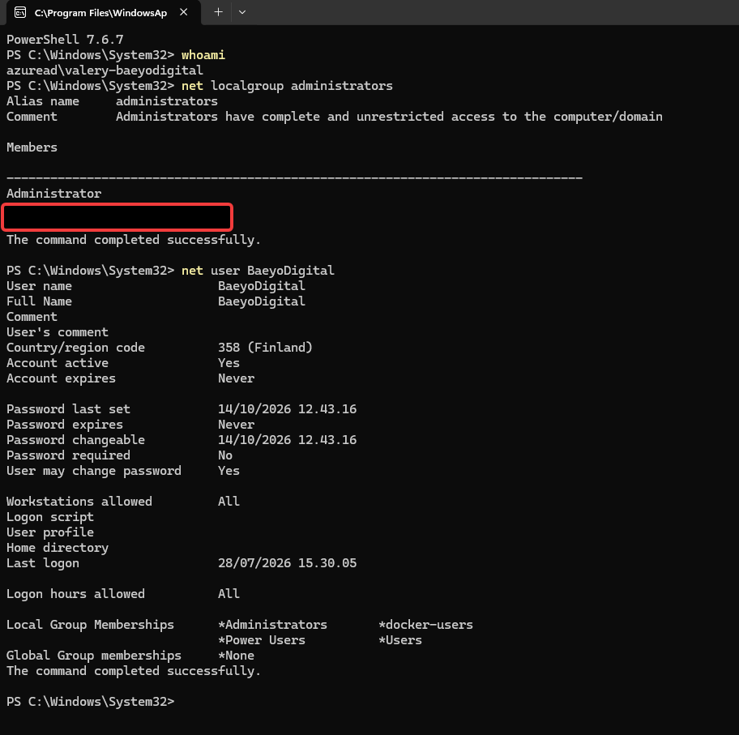
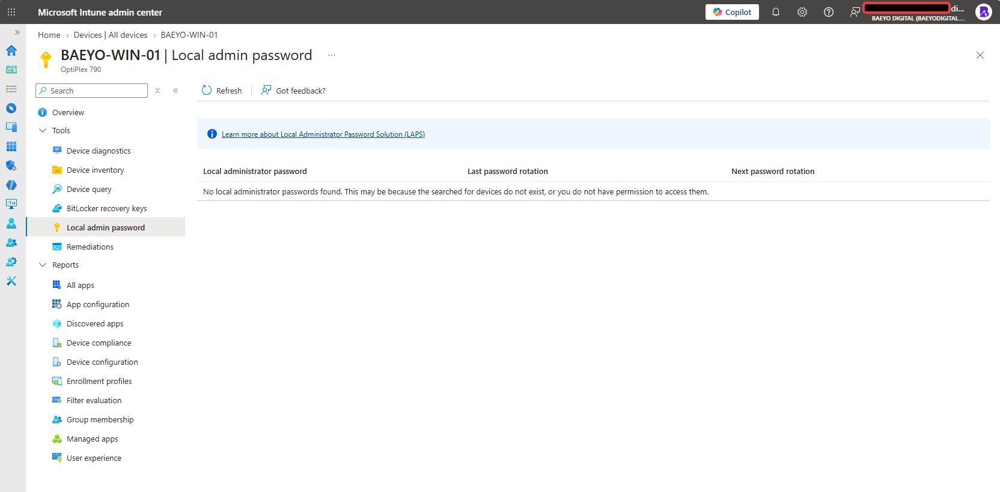
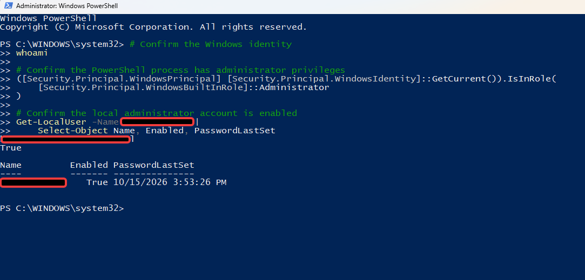

# Windows Local Administrator Recovery on an Entra-Joined Workstation

**Baeyo Digital · Microsoft 365 Administration Portfolio**

| Field | Details |
|---|---|
| Incident identified | 14 October 2026 |
| Recovery confirmed | 18 October 2026 |
| Platform | Windows 11 Pro, Microsoft Entra ID, Microsoft Intune |
| Environment | Baeyo Digital administration lab |
| Result | Local administrative access restored without rebuilding the device |
| Root cause | Undetermined |

> **Publication note:** This is a sanitized account of a real lab troubleshooting exercise. Administrative identities have been anonymized. The screenshots show diagnostic evidence and post-recovery validation; they do not contain a recording of the password-reset operation.

## Overview

An Intune-managed, Microsoft Entra-joined Windows 11 workstation was configured with separate identities for routine work, privileged cloud administration, and local Windows administration. When the local administrator password could no longer be used, tasks requiring elevation were interrupted even though the normal Windows session continued to work.

The objective was to restore authorized local administrator access **without resetting Windows, rejoining Microsoft Entra ID, or recreating the workstation**.

## Environment and account separation

| Identity (anonymized) | Purpose |
|---|---|
| Daily work account | Microsoft 365 productivity, project documentation, Git and development work |
| Cloud administrator | Authorized Microsoft Entra, Intune and tenant administration; separate from daily use |
| Local administrator | Local Windows administration and recovery on the workstation |

Maintaining these distinct identities made an alternative, authorized recovery route available when the local credential could not be used.

## Investigation

### 1. Windows password-reset attempt

The sign-in recovery option opened a **No Drive** dialog requesting previously prepared removable password-reset media. An ordinary USB drive would not have solved this, because the required reset disk must have been created in advance.


### 2. Read-only Windows account checks

From the working daily Windows session, PowerShell was used to inspect the current identity, local Administrators group and affected local account:

```powershell
whoami
net localgroup administrators
net user "<LOCAL_ADMIN_ACCOUNT>"
```

`<LOCAL_ADMIN_ACCOUNT>` is a placeholder for the actual local account name; it is intentionally not published.

The output confirmed that the local administrator account **existed, was active, and retained its Administrators group membership**. These checks did not modify the device.



### 3. Intune local administrator password investigation

Using an authorized cloud administrator, the device's **Local admin password** page was checked in Microsoft Intune. No password record was available to retrieve in that session.

**Important:** This did not prove that Windows LAPS had changed the password, nor did it establish that LAPS was disabled. A missing record may have different explanations, including backup configuration and permissions.



## Recovery method

An already-authorized, separate Microsoft Entra administrator identity was used to establish an administrative Windows session. From an **elevated PowerShell** window, the password of the existing local administrator account was reset with the Windows `net user` command:

```powershell
net user "<LOCAL_ADMIN_ACCOUNT>" *
```

The asterisk requests the new password interactively, avoiding plaintext passwords in the command itself. The real account name and new password are intentionally omitted from this public document.

The existing local account was **not deleted or recreated**. The successful password change was confirmed by the operator; no screenshot of the password entry or original reset command was retained.

### Post-recovery validation

A separate, elevated PowerShell session was opened using the recovered local administrator credentials. Verification checked the effective Windows identity, administrative token and account-enabled status:

```powershell
whoami
([Security.Principal.WindowsPrincipal] [Security.Principal.WindowsIdentity]::GetCurrent()).IsInRole(
    [Security.Principal.WindowsBuiltInRole]::Administrator
)
Get-LocalUser -Name "<LOCAL_ADMIN_ACCOUNT>" |
    Select-Object Name, Enabled, PasswordLastSet
```

The elevation test returned **`True`** and the account was **enabled**. The post-recovery evidence recorded a password-last-set date of **15 October 2026**; successful access was subsequently confirmed by **18 October 2026**.



## Results

- Authorized local Windows administrator access was restored.
- The existing local account and Windows installation were retained.
- No Windows reset, Microsoft Entra disconnection or Intune re-enrollment was required for the recovery.
- No passwords, recovery keys or authentication secrets were added to the case-study repository.
- The original cause of the password problem remains **undetermined**.

## Root-cause limitations

During the initial investigation, Windows reported a password-last-set timestamp on **14 October 2026**, even though no deliberate password change was recalled. That observation alone cannot identify what changed the credential, who or what initiated the change, or whether password-management automation was involved.

It would therefore be inaccurate to describe this as a confirmed LAPS rotation incident, a compromised account, or an Intune failure.

## Lessons learned

1. Maintain a working, tested recovery route rather than assuming a local administrator password will remain available indefinitely.
2. Keep standard daily-use identities separate from privileged administration identities.
3. Check account state and administrator membership before attempting disruptive recovery procedures.
4. Treat the absence of a LAPS password record as a diagnostic observation, not proof of its cause.
5. Prefer an authorized administrator-led reset over unnecessary device reinstallation.
6. Document confirmed evidence separately from hypotheses and follow-up recommendations.

## Follow-up opportunities

Review Windows LAPS policy and password-backup visibility, store recovery credentials in an approved password vault, and maintain a brief administrator-access runbook. These are **recommendations for subsequent work**, not configuration changes performed during this incident.

## Evidence summary

| Evidence | File | Purpose |
|---|---|---|
| E01 | `01-password-reset-error.jpeg` | Recovery-disk limitation |
| E02 | `02-account-diagnostics.png` | Account existence, status and membership |
| E03 | `03-intune-laps-check.png` | Intune password-retrieval investigation |
| E04 | `04-recovery-verification.png` | Working elevated session after recovery |

All images linked above are sanitized public copies. The original incident evidence is retained separately in the private administration lab.

## References

- [Microsoft Learn — `net user` command](https://learn.microsoft.com/en-us/windows-server/administration/windows-commands/net-user)
- [Microsoft Learn — Manage local administrators on Entra-joined devices](https://learn.microsoft.com/en-us/entra/identity/devices/assign-local-admin)
- [Microsoft Learn — Windows LAPS policy in Intune](https://learn.microsoft.com/en-us/intune/intune-service/protect/windows-laps-policy)
